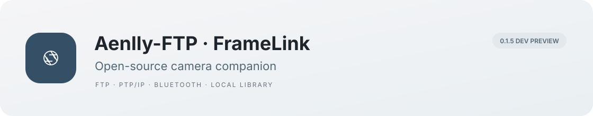
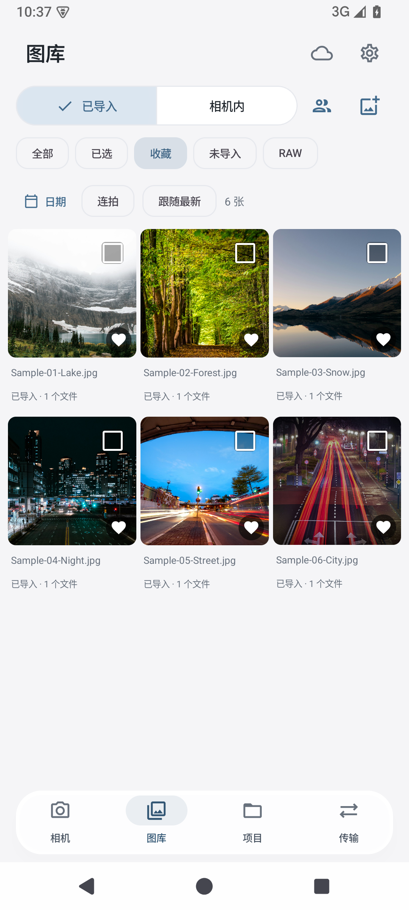
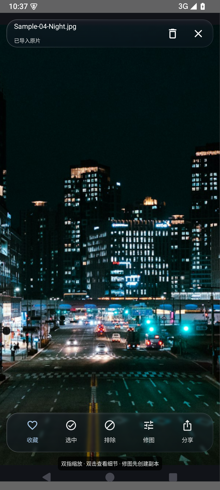
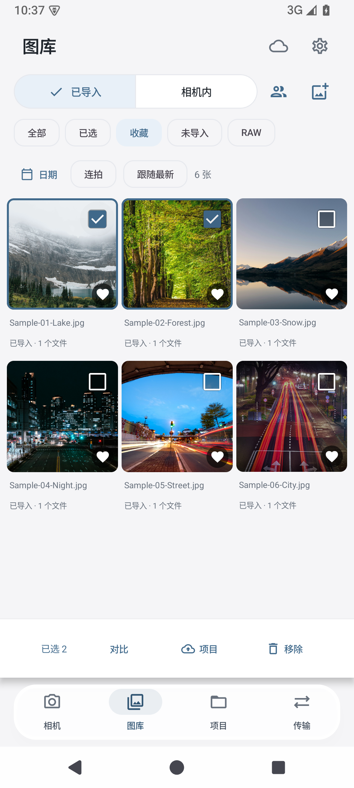

# Aenlly-FTP · FrameLink

<p align="center"></p>

<p align="center"><a href="README.md">中文</a> · <strong>English</strong> · <a href="README.ja.md">日本語</a></p>
<p align="center"> <a href="LICENSE"></a> </p>

FrameLink is an Android app for FTP transfers, camera browsing, remote capture, and photo selection. Local tools work without an account. Remote client proofing requires a configured or self-hosted cloud server.

[Screenshots](#screenshots) · [Features](#features) · [Getting started](#getting-started) · [Contributing](CONTRIBUTING.md) · [Issues](https://github.com/Aenlly/Aenlly-FTP-FrameLink/issues)

> **0.1.3 development build.** Local and emulator results are in the [test report](docs/IMPLEMENTATION.md). Sony A7C II is the first target; real-camera wireless, Bluetooth, speed, and battery tests are still pending.

## Screenshots

<table>
<tr><th>Camera home</th><th>Photo library</th><th>Photo viewer</th></tr>
<tr><td></td><td></td><td></td></tr>
<tr><th>Selection and comparison</th><th>Projects and proofing</th><th>Transfer tasks</th></tr>
<tr><td></td><td></td><td></td></tr>
</table>

These are screenshots of the installed app running in an Android 15 emulator. Photographer credits and licenses are listed in the [visual validation notes](docs/VISUAL_QA.md). The sample photographs are not bundled with the app and do not demonstrate real-camera compatibility.

## Features

The app currently uses Chinese interface labels. The README is available in Chinese, English, and Japanese.

| Where to find it | What it does |
|---|---|
| Camera → 选片下载 | Connect, browse camera contents, filter by date or format, and selectively import |
| Camera → 取景拍摄 | Live view, shutter, timer, parameters, and monitoring aids according to device capabilities |
| Camera → FTP 接收 | Receive uploads on the phone; configure port, account, destination, and separate compressed copies |
| Camera → FTP 客户端 | Browse FTP or explicit FTPS servers, create folders, upload files, and download selections |
| Camera → 快速快门 / 本机导入 | Bluetooth shutter; import from the phone or a card reader |
| Library → 图库 | Favorites, picks, rejects, full-screen viewing, comparison, burst grouping, on-site client selection, and sharing; remove entries or delete their local files |
| Projects → 项目 | Independent local client choices; optional web sharing, selection rounds, confirmation, and final-file association |
| Transfers → 传输 | Persistent tasks, byte progress, error details, cancellation, retry, opening, and saving files |

Original bytes are preserved; previews and compressed copies are generated separately. Cloud tasks process previews and final files explicitly added to projects. Local capture, FTP, and selection do not require a cloud account. The cloud service requires a self-hosted or configured server.

## Getting started

### Build a development APK

The FrameLink preview does not yet have a separate GitHub Release. Existing historical releases belong to the earlier FTP version; check their version notes before downloading.

The Android app requires Android 8.0/API26 or later. Development builds include arm64 and x86_64 protocol libraries.

Local builds require Python 3.12 or later and JDK17.

```sh
git clone --branch feature/framelink-v1 https://github.com/Aenlly/Aenlly-FTP-FrameLink.git
cd Aenlly-FTP-FrameLink
# Install JDK17 and set JAVA_HOME for your machine first
python3 scripts/bootstrap.py
sh scripts/build-android.sh
```

Output: `artifacts/FrameLink-0.1.3-debug.apk`. The automatic tool setup currently targets macOS Apple Silicon. Other environments need their own Go, Android SDK, and NDK setup; see the [Android guide](android/README.md) and [protocol bridge](camera-bridge/README.md). The APK uses a development certificate. Production signing and distribution are separate steps.

### Connect and transfer

1. **Browse or control a camera:** enable PC Remote and Access Authentication. Enter the IP, username, and password once. The app reads the fingerprint for confirmation and remembers the connection; the password field has a visibility toggle. See the [connection guide](android/README.md).
2. **Receive photographs over FTP:** put both devices on the same Wi-Fi network or connect the camera to the phone's hotspot. Start “FTP 接收” and enter the displayed address, port, username, and password in the camera's FTP settings.
3. **Use an existing file server:** open “FTP 客户端”, configure the server, select remote files to download, or upload using the system file picker.
4. **Use local photographs only:** open “本机导入” and the library without connecting a camera or signing in.

FTP receiving and browsing historical camera contents are independent paths. Use plain FTP on a trusted network; explicit FTPS verifies server certificates. Retries start from the beginning; resumable transfer is not claimed.

### Optional local cloud preview

Prepare JDK17, Maven, and Node.js 24 or 26. Install web dependencies, build the service, then run the backend and web app in separate terminals:

```sh
(cd web && npm ci)
python3 scripts/check.py cloud-package
python3 scripts/dev.py cloud
# In another terminal
python3 scripts/dev.py web
```

Open `http://localhost:5177`. The local test invitation code is `local-dev-only`, for development previews only. See the [server](cloud/README.md) and [web client](web/README.md) guides for configuration. A public cloud service has not been deployed.

## Compatibility and validation

| Area | Current status |
|---|---|
| Android | Development APK available; isolated-emulator checks cover navigation, import, FTP, and selection |
| Sony A7C II | First adaptation target; protocol integration exists, with firmware-specific wireless and Bluetooth validation pending |
| FTP client | Local-server tests cover bytes, Chinese filenames, collision protection, cancellation, and retry; production FTPS remains unqualified |
| Cloud delivery | Local tests cover proofing through final downloads; production MySQL/S3, public HTTPS, and deployment remain pending |
| Performance | Streaming originals and separate preview processing are retained; no same-camera/network speed or battery comparison has been published |

Use the [hardware checklist](docs/HARDWARE_ACCEPTANCE.md) and this project's own evidence. Another application's camera support does not establish FrameLink compatibility.

## Project structure

```text
android/          Kotlin + Jetpack Compose Android app
camera-bridge/    Go camera protocol bridge, producing an Android AAR
cloud/            Spring Boot selection, authorization, and delivery service
web/              React photographer workspace and client website
third_party/      Pinned upstream source and original licenses
docs/             Usage, validation, interface, and collaboration notes
scripts/          Local build, test, and development tools
```

[Collaboration](docs/REVIEW.md) · [FTP](docs/FTP_AND_UI.md) · [Visual validation](docs/VISUAL_QA.md) · [Implementation report](docs/IMPLEMENTATION.md)

Detailed module guides and validation notes are currently written in Chinese.

## Contributing

Reproducible issues, real-camera results, interface improvements, and translations are welcome. Include the phone system, camera firmware, connection type, and actual outcome in [GitHub Issues](https://github.com/Aenlly/Aenlly-FTP-FrameLink/issues). See [CONTRIBUTING.md](CONTRIBUTING.md) for code changes and validation.

Current priorities are A7C II hardware and background stability, FTPS and system-folder compatibility, invitation testing, and release preparation. USB/card-reader performance, more cameras, and advanced monitoring will follow practical feedback.

## License and acknowledgments

Licensed under [GPL-3.0](LICENSE). Aenlly's original attribution, history, and license are preserved; the earlier implementation is in `third_party/aenlly-ftp/`. Thanks to [alpha2go](https://github.com/Knallli/alpha2go), [α-Remote](https://github.com/Staacks/alpharemote), [SonnyLink](https://github.com/XiaoQAQ10086/SonnyLink), Apache Commons Net, Haze, and their contributors. Versions and usage are documented in [THIRD_PARTY_NOTICES.md](THIRD_PARTY_NOTICES.md).

If you can test with a camera, please include its model and firmware, your phone system, and the connection method. Reports of what failed are useful too.
