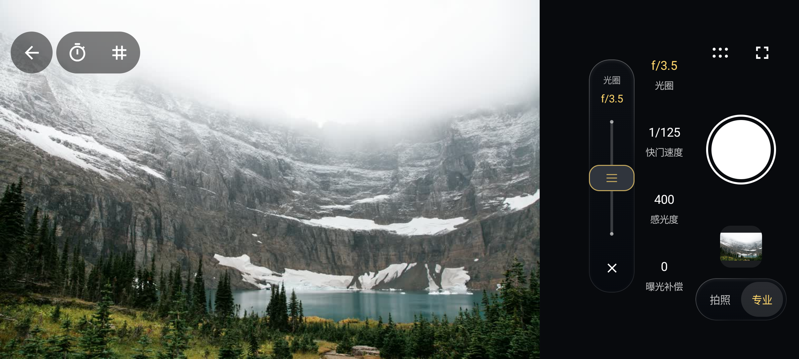

# Aenlly-FTP · FrameLink
<p align="center"></p>
<p align="center"><a href="README.md">中文</a> · <a href="README.en.md">English</a> · <strong>日本語</strong> · <a href="README.ko.md">한국어</a></p>

カメラにつなぎ、写真を見て、必要なものだけ取り込む。FrameLinkはAenlly-FTPをもとに、FTP転送に加えてライブビュー、現場での写真選定、任意のクラウド納品を開発しているオープンソースアプリです。

**開発プレビュー：Android 0.1.12／iOS 0.1.6** · Android 17対応（8.0以降） · iOS 17以降のプロジェクト · GPL-3.0

## 画面
| カメラ | ギャラリー | 写真表示 |
|---|---|---|
|  |  |  |

Androidエミュレーターの画面です。許諾済みの作例を使用しています。[素材と画面確認](docs/VISUAL_QA.md)



## 主な機能
- **カメラ**：接続情報の保存、初回の指紋確認、カード内の閲覧、原本の取り込み、ライブビュー、対応機種での遠隔操作。 Androidでは画面をタップしてピントを合わせ、撮影後の自動取り込みは初期状態でオフです。
- **ギャラリー**：RAW＋JPEGのまとめ表示、長押しドラッグ選択、一覧と大きな写真での選択共有、お気に入り、比較、名前付きの選定記録とコンタクトシート。Androidのカメラ内一覧は撮影日時の新しい順に表示し、スクロールすると続きが自動で読み込まれます。
- **現場での選定**：顧客名・電話番号・撮影名を付けた記録、顧客独自の選択とコメント、名前変更、削除、確定と再編集。
- **FTP**：カメラからの受信、FTP／明示的FTPSでの閲覧、アップロード、ダウンロード、フォルダー作成。
- **端末内の管理**：スマートフォンやカードリーダーから取り込み、一覧だけの削除、またはアプリ内コピーの削除。カメラ内の原本は削除しません。
- **納品**：AndroidとWebから自分で設置したクラウドに接続し、アクセスコードによる写真選定と仕上がり写真のダウンロード。

ローカル機能にアカウントは不要です。原本のバイト列を保持し、プレビューや圧縮画像は別に作成します。iOS初版は端末内の管理、顧客記録、ソニー無線接続、FTPに対応する実装です。BluetoothとクラウドはiOS未対応です。[機能範囲と検証](docs/IMPLEMENTATION.md)

## 接続
**FTP受信はメーカーを限定しません。** カメラ側にFTP送信機能が必要です。同じWi-Fiまたはスマートフォンのホットスポットに接続して「FTP 接收」を開始し、端末のIPアドレス、ポート、ユーザー名、パスワードをカメラに設定します。

**無線閲覧と遠隔操作は現在ソニー用アダプターを使用します。** PCリモートと必要な認証を有効にしてカメラのIPアドレスを入力し、指紋を確認します。機種やファームウェアによって使える機能が異なります。接続できない場合はFTPまたはローカル取り込みを使えます。A7C IIの一部実機確認を記録していますが、ほかの機種は検証が必要です。[接続手順](android/README.md#连接相机)

通常のFTPは信頼できるLANで使用してください。明示的FTPSは証明書を検証します。iOSでは受信中にアプリを前面に保つ必要があります。失敗した転送は先頭から再試行します。

## ビルド
開発プレビューはまだReleasesに公開していません。既存のリリースは旧FTP版です。
```sh
git clone --branch feature/framelink-v1 https://github.com/Aenlly/Aenlly-FTP-FrameLink.git
cd Aenlly-FTP-FrameLink
# macOS Apple Silicon。先にJDK17をインストール
python3 scripts/bootstrap.py
sh scripts/build-android.sh
# 完全版XcodeとiOS SDKが必要
sh scripts/build-ios.sh
```

Androidの出力：`artifacts/FrameLink-0.1.12-debug.apk`。iPhone用IPAは再署名が必要です。[インストール手順](ios/INSTALL.md)。シミュレーター用ファイルは別です。アプリの表示言語は現在中国語です。[Android](android/README.md) · [iOS](ios/README.md) · [サーバー](cloud/README.md) · [Web](web/README.md)

## 開発に参加
対応機種の報告、不具合の再現手順、使い勝手への意見を歓迎します。スマートフォンのOS、カメラの型番とファームウェア、接続方法を記載し、パスワードや個人の原本写真は送らないでください。

[Issues](https://github.com/Aenlly/Aenlly-FTP-FrameLink/issues) · [貢献ガイド](CONTRIBUTING.md) · [開発と確認](docs/REVIEW.md) · [実機チェック](docs/HARDWARE_ACCEPTANCE.md)

## ライセンス
[GPL-3.0](LICENSE)。Aenllyの原著作者表記と履歴を保持し、旧版ソースは`third_party/aenlly-ftp/`にあります。alpha2go、α-Remote、SonnyLink、Apache、Hazeに感謝します。[バージョン・ライセンス・利用方法](THIRD_PARTY_NOTICES.md)
