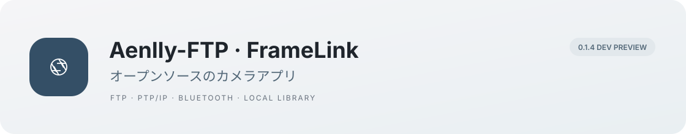

# Aenlly-FTP · FrameLink

<p align="center"></p>

<p align="center"><a href="README.md">中文</a> · <a href="README.en.md">English</a> · <strong>日本語</strong></p>
<p align="center"> <a href="LICENSE"></a> </p>

FrameLinkは、FTP送受信、カメラ内の写真閲覧、リモート撮影、写真選定をまとめたAndroidアプリです。ローカル機能にアカウントは不要です。顧客向けの遠隔写真セレクトには、クラウドサーバーの設定または自己ホストが必要です。

[スクリーンショット](#スクリーンショット) · [主な機能](#主な機能) · [使い始める](#使い始める) · [開発への参加](CONTRIBUTING.md) · [問題の報告](https://github.com/Aenlly/Aenlly-FTP/issues)

> 現在は **0.1.2開発テスト版** です。ローカルとエミュレーターの結果は[テスト記録](docs/IMPLEMENTATION.md)をご覧ください。最初の対象はSony A7C IIです。実機での無線接続、Bluetooth、速度、電池消費は今後確認します。

## スクリーンショット

<table>
<tr><th>カメラホーム</th><th>写真ライブラリ</th><th>写真ビューアー</th></tr>
<tr><td></td><td></td><td></td></tr>
<tr><th>選定と比較</th><th>プロジェクト</th><th>転送タスク</th></tr>
<tr><td></td><td></td><td></td></tr>
</table>

実際のインストール済みアプリをAndroid 15エミュレーターで動作させた画面です。写真の作者、出典、ライセンスは[表示検証と素材の記録](docs/VISUAL_QA.md)をご覧ください。写真はアプリに同梱せず、実機カメラの互換性を示すものでもありません。

## 主な機能

アプリのUIは現在中国語です。READMEは中国語、英語、日本語で提供しています。

| 操作場所 | できること |
|---|---|
| カメラ → 选片下载 | カメラ接続、保存済み写真の閲覧、日付・形式の絞り込み、選択した写真の取り込み |
| カメラ → 取景拍摄 | 機器の対応状況に応じたライブビュー、シャッター、タイマー、設定値と撮影補助 |
| カメラ → FTP 接收 | スマートフォンで受信し、ポート、アカウント、保存先、圧縮コピーを設定 |
| カメラ → FTP 客户端 | FTP・明示的FTPSのフォルダー閲覧、フォルダー作成、アップロードと選択ダウンロード |
| カメラ → 快速快门 / 本机导入 | Bluetoothシャッター、スマートフォンやカードリーダーからの写真取り込み |
| ライブラリ → 图库 | お気に入り、採用・除外のマーク、拡大表示、二枚比較、連写グループ、顧客選定とシステム共有 |
| プロジェクト → 项目 | 顧客の選択を独立して保存。任意のWeb共有、選定ラウンド、確認、仕上がり写真との関連付け |
| 転送 → 传输 | 永続化されたタスク、バイト進捗、失敗理由、キャンセル、再試行、ファイルを開く・別名で保存 |

原本のバイト列を保持し、プレビューと圧縮コピーは別に生成します。クラウドでは、プロジェクトへ明示的に追加したプレビューと仕上がり写真を処理します。ローカル撮影、FTP、写真選定にクラウドアカウントは不要です。クラウド機能はサーバーの自己ホスト、または接続先の設定が必要です。

## 使い始める

### 開発用APKをビルドする

FrameLink開発プレビュー専用のGitHub Releaseは、まだ公開していません。既存の過去のReleaseは初期のFTP版です。ダウンロード前にバージョン説明をご確認ください。

Android 8.0/API26以上が必要です。開発ビルドにはarm64とx86_64のプロトコルライブラリを含みます。

ローカルビルドにはPython 3.12以上とJDK17が必要です。

```sh
git clone --branch feature/framelink-v1 https://github.com/Aenlly/Aenlly-FTP.git
cd Aenlly-FTP
# 事前にJDK17をインストールし、環境に合わせてJAVA_HOMEを設定
python3 scripts/bootstrap.py
sh scripts/build-android.sh
```

出力先は`artifacts/FrameLink-0.1.2-debug.apk`です。ツールの自動準備スクリプトは現在macOS Apple Silicon向けです。それ以外の環境ではGo、Android SDK、NDKを別途準備してください。[Androidガイド](android/README.md)と[プロトコルブリッジ](camera-bridge/README.md)に説明があります。APKは開発用証明書で署名し、正式な署名と配布は別の工程として扱います。

### 接続と転送

1. **カメラの閲覧・操作**：カメラでPCリモートのWi-Fi接続を有効にし、機器に表示されたIPと認証情報を入力します。[接続ガイド](android/README.md)をご覧ください。
2. **撮影中のFTP受信**：同じWi-Fi、またはスマートフォンのテザリングに接続します。「FTP 接收」を開始し、表示されたアドレス、ポート、ユーザー名、パスワードをカメラのFTP設定に入力します。
3. **既存ファイルサーバーを使う**：「FTP 客户端」にサーバー情報を入力し、ダウンロードするファイルを選ぶか、システムのファイル選択画面からアップロードします。
4. **端末内の写真だけを使う**：「本机导入」とライブラリは、カメラ接続やログインなしで利用できます。

FTP受信とカメラ内の過去の写真の閲覧は、別の通信経路です。通常のFTPは信頼できるネットワークで使用し、明示的FTPSではサーバー証明書を検証します。再試行は先頭から行い、途中再開の対応は保証していません。

### 任意：クラウド機能をローカルで確認する

JDK17、Maven、Node.js 24または26を準備します。Webの依存関係をインストールしてサービスをビルドし、バックエンドとWebを別々のターミナルで起動します。

```sh
(cd web && npm ci)
python3 scripts/check.py cloud-package
python3 scripts/dev.py cloud
# 別のターミナル
python3 scripts/dev.py web
```

`http://localhost:5177`を開きます。ローカル検証用の招待コードは`local-dev-only`です。開発プレビュー専用の設定です。[サーバー](cloud/README.md)と[顧客向けWeb](web/README.md)のガイドに設定方法があります。公開クラウドサービスは未稼働です。

## 互換性と検証

| 対象 | 現在の状態 |
|---|---|
| Androidアプリ | 開発用APKを提供。独立エミュレーターで画面遷移、取り込み、FTP、写真選定を確認 |
| Sony A7C II | 最初の対応目標。プロトコルを統合済みですが、固有のファームウェア、無線接続、Bluetoothは実機検証待ち |
| FTPクライアント | ローカルサーバーでバイト一致、中国語のファイル名、同名保護、キャンセルと再試行を確認。本番FTPSは未検証 |
| クラウド納品 | 写真選定から仕上がり写真のダウンロードまでをローカル検証。本番MySQL/S3、公開HTTPS、デプロイは未検証 |
| 性能 | 原本のストリーミング転送とプレビュー処理の分離を維持。同じカメラ・ネットワークでの速度や電池消費の比較結果は未公表 |

[実機チェックリスト](docs/HARDWARE_ACCEPTANCE.md)と本プロジェクトの記録に基づいて判断してください。他のアプリが対応する機種でも、FrameLinkで検証済みとは限りません。

## プロジェクト構成

```text
android/          Kotlin + Jetpack ComposeのAndroidアプリ
camera-bridge/    Android AARを生成するGoカメラプロトコルブリッジ
cloud/            Spring Bootの写真選定・権限・納品サービス
web/              Reactの撮影者向けワークスペースと顧客向けWeb
third_party/      バージョンを固定した上流コードと元のライセンス
docs/             使い方、検証、画面設計、共同開発の記録
scripts/          ローカルビルド、テスト、開発ツール
```

[共同開発](docs/REVIEW.md) · [FTP](docs/FTP_AND_UI.md) · [表示検証](docs/VISUAL_QA.md) · [実装と検証](docs/IMPLEMENTATION.md)

モジュールの詳細ガイドと検証記録は、現在中国語で記載しています。

## 開発への参加

再現可能な問題の報告、実機での動作記録、画面改善、翻訳を歓迎します。[GitHub Issues](https://github.com/Aenlly/Aenlly-FTP/issues)にはスマートフォンのOS、カメラのファームウェア、接続方法、実際の結果を記載してください。コードの変更と検証は[CONTRIBUTING.md](CONTRIBUTING.md)をご覧ください。

現在はA7C IIの実機・バックグラウンド安定性、FTPSとシステム保存先の互換性、招待テスト、正式公開の準備を優先しています。USB・カードリーダーでの高速取り込み、対応機種、専門的なモニタリング機能は実際のフィードバックをもとに進めます。

## ライセンスと謝辞

[GPL-3.0](LICENSE)で公開しています。Aenllyの元の署名、履歴、ライセンスを保持し、初期の実装は`third_party/aenlly-ftp/`に保存しています。[alpha2go](https://github.com/Knallli/alpha2go)、[α-Remote](https://github.com/Staacks/alpharemote)、[SonnyLink](https://github.com/XiaoQAQ10086/SonnyLink)、Apache Commons Net、Hazeと各貢献者に感謝します。固定バージョンと利用内容は[THIRD_PARTY_NOTICES.md](THIRD_PARTY_NOTICES.md)をご覧ください。

実機で試せる方は、カメラの型番とファームウェア、スマートフォンのOS、接続方法を添えて結果を教えてください。動かなかった場合の記録も役立ちます。
