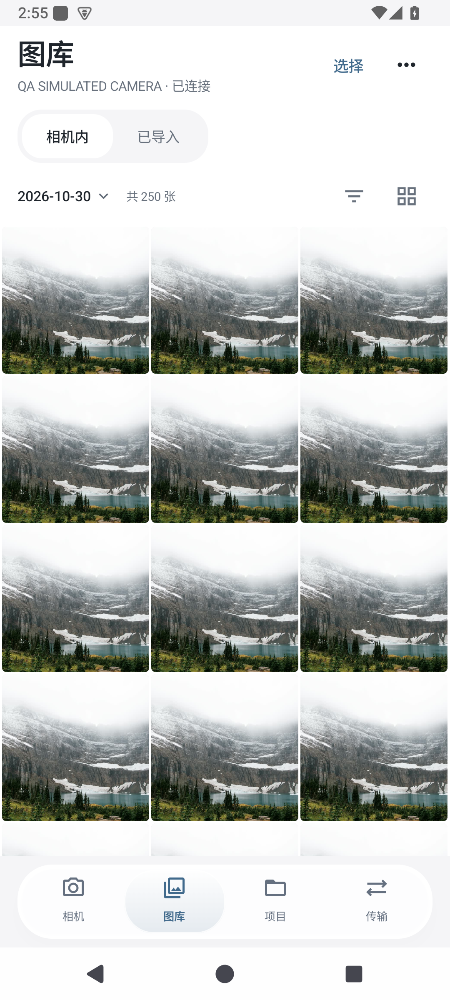
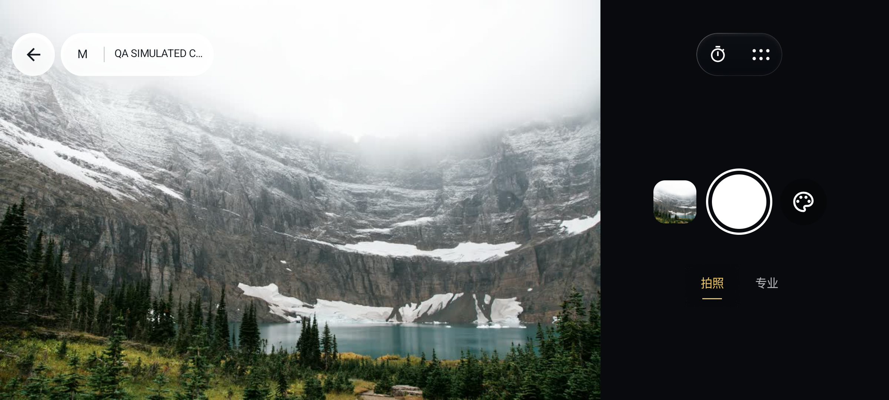

# Aenlly-FTP · FrameLink
<p align="center"></p>
<p align="center"><a href="README.md">中文</a> · <a href="README.en.md">English</a> · <a href="README.ja.md">日本語</a> · <strong>한국어</strong></p>

카메라에 연결하고, 사진을 살펴보고, 필요한 사진만 가져옵니다. FrameLink는 Aenlly-FTP를 바탕으로 FTP 전송을 유지하면서 무선 라이브 뷰, 현장 사진 선택, 선택형 클라우드 납품 기능을 개발하는 오픈 소스 앱입니다.

**개발 프리뷰: Android 0.1.25 / iOS 0.1.10** · Android 17 지원（최소 8.0） · iOS 17 이상 프로젝트 · GPL-3.0

## 화면
| 카메라 | 갤러리 | 사진 보기 |
|---|---|---|
|  |  |  |

Android 에뮬레이터 화면이며 사용 허가를 받은 샘플 사진을 사용했습니다. [사진 출처와 화면 검증](docs/VISUAL_QA.md)



## 주요 기능
- **카메라**: 연결 정보를 기억하고 기종이 지원하는 라이브 뷰, 원격 촬영, 크리에이티브 룩을 제공합니다. Android 휴대전화에서는 조작 위치를 유지한 채 아이콘이 회전하며 화면을 눌러 초점을 맞춥니다. 촬영 후 자동 가져오기는 선택할 수 있으며 기본은 꺼짐입니다.
- **갤러리**: RAW＋JPEG를 묶고 날짜 범위의 전체 사진 수를 표시합니다. 목록은 백그라운드에서 채우고 썸네일은 필요할 때 가져옵니다. 소·중·대 격자와 목록, 드래그 다중 선택, 사진 보기와 목록의 선택 동기화를 지원합니다.
- **사진 확인**: 넘기기, 확대, 즐겨찾기, 비교, 이름을 붙인 기록과 이미지 목록. “查看原片”은 JPEG를 임시 캐시에 받고 가져오기 완료로 표시하지 않습니다. 정식 가져오기는 일치하는 캐시를 재사용합니다. 캐시는 약 2GB까지이며 저장된 사진이나 선택 기록을 지우지 않고 수동으로 비울 수 있습니다.
- **사진 정보**: EXIF의 ISO, 셔터 속도, 조리개, 초점 거리, 렌즈, 기종, 촬영 시간과 기록된 GPS를 읽습니다. 없는 값을 현재 카메라 설정이나 휴대전화 위치로 채우지 않습니다.
- **현장 선택**: 고객 이름·전화번호·촬영명으로 기록하고, 고객의 선택과 메모를 별도로 저장합니다. 이름 변경, 기록 삭제, 완료 및 재수정이 가능합니다.
- **FTP**: 카메라 업로드 수신, FTP 및 명시적 FTPS 서버 탐색, 업로드, 다운로드, 폴더 만들기.
- **연결과 기록**: 여러 기기의 계정과 비밀번호를 선택적으로 암호화해 저장하고, 연결을 전환하거나 잊을 수 있습니다. 완료·취소된 전송 기록만 지우며 파일과 대기 중인 작업은 유지합니다.
- **로컬 관리**: 휴대전화나 카드 리더에서 가져오기, 목록에서만 제거하거나 앱에 저장된 복사본 삭제. 카메라 카드의 원본은 삭제하지 않습니다.
- **납품**: Android와 웹에서 직접 배포한 클라우드에 연결해 접근 코드로 사진을 고르고 완성본을 다운로드할 수 있습니다.

로컬 기능에는 계정이 필요 없습니다. 원본 바이트를 유지하고 미리 보기와 압축 이미지는 따로 만듭니다. iOS 첫 버전에는 로컬 갤러리, 고객 기록, 소니 무선 연결, FTP 구현이 포함됩니다. iOS의 Bluetooth와 클라우드는 아직 연결되지 않았습니다. [플랫폼별 범위와 검증](docs/IMPLEMENTATION.md)

## 연결
**FTP 수신은 브랜드를 제한하지 않습니다.** 카메라가 FTP 업로드를 지원해야 합니다. 같은 Wi-Fi 또는 휴대전화 핫스폿에 연결한 뒤 “FTP 接收”를 시작하고, 휴대전화 주소·포트·계정·비밀번호를 카메라에 입력합니다.

- **Sony 네트워크**: PC 원격 제어와 필요한 인증을 켜고 주소와 지문을 확인합니다. 기능은 기종·펌웨어·협상 결과에 따릅니다. A7C II 실기기 기록이 있으며 다른 대상 기종은 검증이 필요합니다.
- **Canon CCAPI, 실험 단계**: 카메라에서 CCAPI를 활성화하고 HTTP 주소·포트·필요한 계정을 입력합니다. EOS850D는 실기기 테스트 대상입니다. 현재 증거는 독립 서비스 및 Android 모의 테스트이며 실제 카메라 결과는 없습니다.
- **USB 읽기, 실험 단계**: 휴대전화 OTG로 PTP/MTP 기기의 사진 원본을 탐색하고 가져옵니다. 원격 촬영은 제공하지 않습니다. X-T30 II 실기기 검증이 남아 있고 후지필름 무선 원격 제어는 미구현입니다. 시스템이 마운트한 저장장치는 로컬 가져오기를 사용합니다.

새 CCAPI 및 USB 항목은 Android 전용입니다. [연결 안내](android/README.md#连接相机) · [연결 방식과 검증 현황](docs/CAMERA_BACKENDS.md)

일반 FTP는 신뢰할 수 있는 로컬 네트워크에서 사용하세요. 명시적 FTPS는 서버 인증서를 검증합니다. iOS에서 수신할 때는 앱을 전면에 유지해야 합니다. 재시도·이어받기 동작은 연결 방식에 따라 다르므로 연결 안내를 확인하세요.

## 빌드
개발 프리뷰는 아직 Releases에 배포하지 않았습니다. 기존 릴리스는 이전 FTP 버전입니다.
```sh
git clone --branch feature/framelink-v1 https://github.com/Aenlly/Aenlly-FTP-FrameLink.git
cd Aenlly-FTP-FrameLink
# macOS Apple Silicon, 먼저 JDK17 설치
python3 scripts/bootstrap.py
sh scripts/build-android.sh
# 전체 Xcode와 iOS SDK 필요
sh scripts/build-ios.sh
```

Android 소스 빌드 결과물: `android/app/build/outputs/apk/debug/app-debug.apk`. iPhone용 IPA는 다시 서명해야 합니다. [설치 안내](ios/INSTALL.md). 시뮬레이터 파일은 별도로 제공됩니다. 현재 앱의 표시 언어는 중국어입니다. [Android](android/README.md) · [iOS](ios/README.md) · [서버](cloud/README.md) · [웹](web/README.md)

## 기여
기종 호환성, 재현 가능한 오류, 사용성 의견을 환영합니다. 휴대전화 OS, 카메라 모델과 펌웨어, 연결 방식, 재현 단계를 적어 주세요. 비밀번호나 개인 원본 사진은 올리지 마세요.

[Issues](https://github.com/Aenlly/Aenlly-FTP-FrameLink/issues) · [기여 안내](CONTRIBUTING.md) · [개발 및 검증](docs/REVIEW.md) · [실기기 체크리스트](docs/HARDWARE_ACCEPTANCE.md)

## 라이선스
[GPL-3.0](LICENSE). Aenlly의 원저작자 표시와 이력을 유지하며 이전 소스는 `third_party/aenlly-ftp/`에 있습니다. alpha2go, α-Remote, SonnyLink, Apache, Haze에 감사드립니다. [버전·라이선스·사용 방식](THIRD_PARTY_NOTICES.md)
