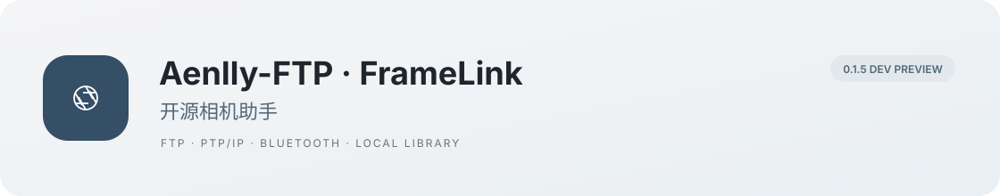

# Aenlly-FTP · FrameLink

<p align="center"></p>

<p align="center"><strong>中文</strong> · <a href="README.en.md">English</a> · <a href="README.ja.md">日本語</a></p>
<p align="center"> <a href="LICENSE"></a> </p>

FrameLink是一个Android相机工具，支持FTP收发、相机照片浏览、遥控拍摄和选片。本地功能不需要账号；客户远程选片需要配置或自行部署云服务。

[界面预览](#界面预览) · [功能入口](#功能入口) · [快速开始](#快速开始) · [参与贡献](CONTRIBUTING.md) · [反馈问题](https://github.com/Aenlly/Aenlly-FTP-FrameLink/issues)

> 当前是 **0.1.3开发测试版**。本地和模拟器测试见[验证记录](docs/IMPLEMENTATION.md)。先适配Sony A7C II，真机无线、蓝牙、速度和耗电还要实测。

## 界面预览

<table>
<tr><th>紧凑首页</th><th>照片图库</th><th>沉浸大图</th></tr>
<tr><td></td><td></td><td></td></tr>
<tr><th>选片与比较</th><th>项目与客户选片</th><th>传输任务</th></tr>
<tr><td></td><td></td><td></td></tr>
</table>

截图来自实际安装包在Android 15模拟器中的运行。摄影样片来源、作者与许可见[视觉验收与素材说明](docs/VISUAL_QA.md)，不随App预装，也不作为真实相机兼容证据。

## 功能入口

| 在哪里 | 可以做什么 |
|---|---|
| 相机 → 选片下载 | 连接相机、浏览历史照片、按日期和格式筛选、选择下载 |
| 相机 → 取景拍摄 | 实时取景、快门、倒计时、参数调整与专业辅助，按设备能力显示 |
| 相机 → FTP 接收 | 手机作为接收端；自定义端口、账号、保存目录和独立压缩副本 |
| 相机 → FTP 客户端 | 连接FTP或显式FTPS服务器，浏览目录、新建文件夹、上传与多选下载 |
| 相机 → 快速快门 / 本机导入 | 蓝牙轻量遥控；从手机或读卡器导入照片 |
| 图库 | 收藏、暂选、排除、大图、双图比较、连拍分组、现场客户选片、系统分享；仅移出图库或连同本机文件删除 |
| 项目 | 本地客户选择独立保存；可选云端分享、选片轮次、确认与成片关联 |
| 传输 | 查看持久化任务、字节进度、错误原因、取消与重试，打开或另存已保存文件 |

原文件按原始字节保存，预览和压缩副本单独生成。云端处理主动加入项目的预览与成片；本地拍摄、FTP和选片不要求云账号。云服务需要自行部署或配置服务地址。

## 快速开始

### 获取开发包

FrameLink开发预览暂未单独发布到GitHub Releases，可按下面的步骤构建。仓库已有的历史Release对应早期FTP版本，请根据版本说明选择。

环境：Android 8.0/API26及以上；开发包包含arm64与x86_64协议库。App界面目前为中文，README提供中文、英文和日文。

本地构建需要Python 3.12及以上与JDK17。

```sh
git clone --branch feature/framelink-v1 https://github.com/Aenlly/Aenlly-FTP-FrameLink.git
cd Aenlly-FTP-FrameLink
# 先安装JDK17，并按本机环境设置JAVA_HOME
python3 scripts/bootstrap.py
sh scripts/build-android.sh
```

输出：`artifacts/FrameLink-0.1.3-debug.apk`。当前自动工具准备脚本面向macOS Apple Silicon；其他环境需自行准备Go、Android SDK与NDK，见[Android构建说明](android/README.md)和[协议桥](camera-bridge/README.md)。签名为开发证书，正式签名与发布单独安排。

### 连接与传输

1. **浏览或遥控相机**：在机身开启电脑遥控和访问身份验证，首次填写IP、账号和密码。App自动读取指纹，确认后连接并记住信息；密码支持显示或隐藏，操作见[连接指南](android/README.md#连接相机)。
2. **FTP边拍边传**：让设备加入同一Wi-Fi或手机热点，在“FTP 接收”选择手机地址并启动服务，将地址、端口、账号和密码填入机身FTP设置。
3. **连接已有文件服务器**：打开“FTP 客户端”，填写服务器信息；选中文件下载，或从系统文件选择器上传。
4. **只管理本机照片**：直接使用“本机导入”和图库，不需要先连接相机或登录。

FTP接收与相机历史照片浏览是两条独立通路。普通FTP请用于可信网络；显式FTPS会验证服务器证书。任务重试从头传输，未宣称断点续传。

### 可选：本地预览云端工作流

准备JDK17、Maven和Node.js 24或26，先安装网页依赖并构建服务，再分别启动后端和网页：

```sh
(cd web && npm ci)
python3 scripts/check.py cloud-package
python3 scripts/dev.py cloud
# 另一个终端
python3 scripts/dev.py web
```

访问`http://localhost:5177`。本机测试邀请码为`local-dev-only`，仅供开发预览。部署说明见[服务端](cloud/README.md)与[客户网页](web/README.md)，公网服务尚未上线。

## 兼容与验证

| 范围 | 当前状态 |
|---|---|
| Android应用 | 已提供开发测试包；独立模拟器检查导航、导入、FTP与选片等流程 |
| Sony A7C II | 首个适配目标，协议实现已接入；具体固件、真实无线和蓝牙待实测 |
| FTP客户端 | 本机服务器验证上传下载、中文名称、同名保护、取消和失败重试；生产FTPS仍待验收 |
| 云端交付 | 本地验证客户选片到成片下载；实际MySQL/S3、公网HTTPS与部署待验收 |
| 性能 | 保留流式原片传输与分离预览调度；尚无同相机、同网络的提速或耗电对照结论 |

设备适配请以[真机清单](docs/HARDWARE_ACCEPTANCE.md)和本项目的实际记录为准。其他软件支持某台相机，不等于FrameLink已经验证。

## 工程与开发

```text
android/          Kotlin + Jetpack Compose Android应用
camera-bridge/    Go相机协议桥，生成Android AAR
cloud/            Spring Boot选片、权限与交付服务
web/              React摄影师工作台和客户网页
third_party/      固定上游源码及原始许可证
docs/             使用、验收、界面与协作记录
scripts/          本地构建、测试与开发工具
```

[协作指南](docs/REVIEW.md) · [FTP功能](docs/FTP_AND_UI.md) · [视觉验收](docs/VISUAL_QA.md) · [实施与验收报告](docs/IMPLEMENTATION.md)

## 参与贡献

欢迎提交可复现的问题、真实机型记录、界面改进和文档翻译。请在[GitHub Issues](https://github.com/Aenlly/Aenlly-FTP-FrameLink/issues)描述手机系统、相机固件、连接方式与实际结果；代码贡献见[CONTRIBUTING.md](CONTRIBUTING.md)。

当前优先事项是A7C II实体机与后台稳定性验收、FTPS和系统文件夹兼容、邀请测试及正式发布准备。USB/读卡器高速导入、更多机型和专业监看工具按实际反馈继续推进。

## 许可与致谢

项目采用[GPL-3.0](LICENSE)。保留Aenlly的原始署名、历史与许可证；早期实现位于`third_party/aenlly-ftp/`。感谢[alpha2go](https://github.com/Knallli/alpha2go)、[α-Remote](https://github.com/Staacks/alpharemote)、[SonnyLink](https://github.com/XiaoQAQ10086/SonnyLink)、Apache Commons Net和Haze等开源项目，固定版本与使用方式见[THIRD_PARTY_NOTICES.md](THIRD_PARTY_NOTICES.md)。

有相机的话，欢迎按清单帮忙测一下。型号、固件、手机系统和连接方式写全，成功或失败的记录都很有用。
