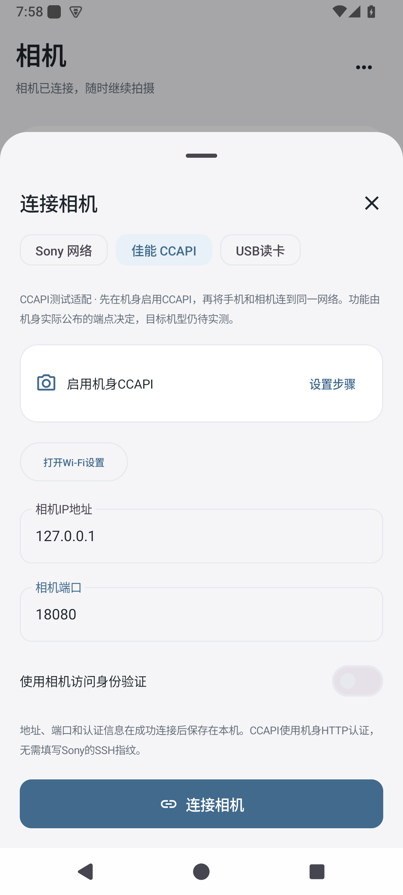
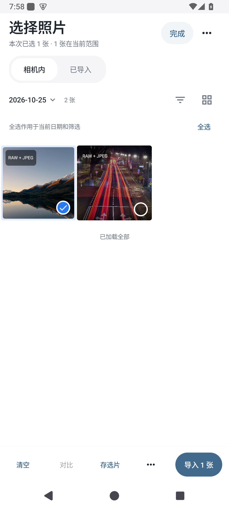
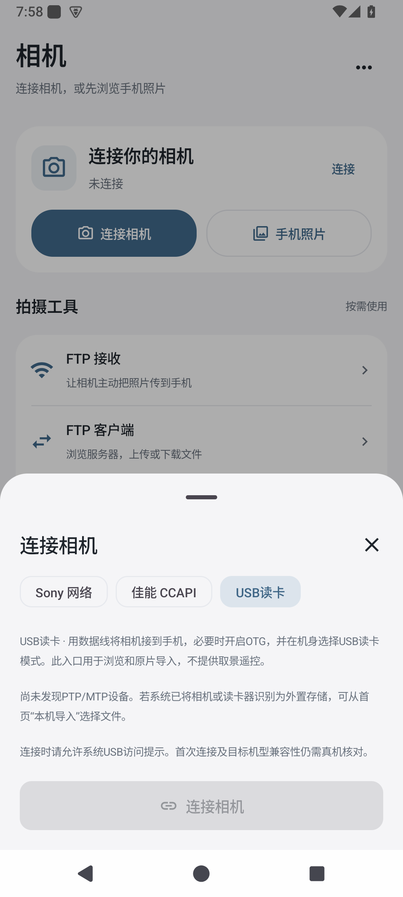

# 相机连接路线与适配记录

0.1.14至0.1.17保留各自冻结记录。当前0.1.18继续补充USB业务回归与有来源的Sony协议证据；下表区分代码、模拟与真机状态，不表示新增机型已经通过硬件验收。

| 机型 | 连接路线 | 原片与媒体 | 控制能力如何确定 | 当前证据 |
|---|---|---|---|---|
| Canon EOS 850D | 相机启用CCAPI后，通过Wi-Fi访问机身HTTP地址 | 已接入contents分页、独立预览及JPEG／CR3原字节下载 | GET /ccapi逐端点协商；已实现曝光枚举读写、取景、点位＋AF半按释放、单张保护及模式恢复 | Go协议服务、Android JNI与图库／导入任务、配置重连模拟均通过；未取得850D机身与固件实测 |
| Fujifilm X-T30 II | 手机无线连接／蓝牙配对、PC AutoSave、USB CARD READER分别处理 | USB PTP/MTP读卡及默认关闭的AutoSave待传批次实验后端；两者都不是手机无线副本通道 | 仅媒体读取，不提供遥控、删除、格式化或设置恢复；Android普通UI未开放，iOS源码有独立实验入口 | USB假设备与业务回归通过；AutoSave发现／注册／原片协议模拟通过，Android导入另行记录；iOS仅软件与源码候选，真实USB与无线均待机身验证 |
| Sony ILCE-7M4 | 复用Sony PTP/IP后端，按机身网络与认证设置连接 | 根据GetDeviceInfo实际公布的浏览、预览、下载操作码开放 | Sony扩展握手返回的控制项与实时属性共同决定 | 新增有来源的公开属性文本投影测试；原始网络载荷及实机待验 |
| Sony ILCE-7M5 | 同上，分别记录固件和接口差异 | 同上 | 同上；桌面SDK名单不能证明当前无线驱动已接通 | 新增公开属性差异测试；未解释光圈特殊值不显示为正常数值；网络及实机待验 |
| Sony ILCE-6700 | 同上 | 同上 | 同上 | 已将上游真实9209载荷接入桥接回放；PTP/IP外层及控制表仍合成，完整握手和实机待验 |
| Sony ILCE-7CM2 | 保留现有连接、认证、PTP/IP与取景路径 | 保留现有JPEG／RAW分组及原片下载 | 保留能力协商、拍摄保存策略、对焦与快门保护 | 0.1.17红米核心选片与预览接收通过；0.1.18小米17核心选片、横竖屏取景只读检查通过，见acceptance目录；历史证据不替代新版本实测 |

实施顺序：连接与机身信息→媒体索引和缩略图→按字节验证原片下载→接入本地选片与传输→根据已公布能力接取景和控制。相机卡内仍只读，不增加删除、格式化或整机设置恢复。

每条验收记录应包含App版本、机型、固件、连接方式，以及源码／协议模拟／实机三个独立状态。超时快门不自动重发；未公布的功能不作为可用控制。色彩设置分别核实Sony创意外观、Canon照片风格和Fujifilm胶片模拟，不以手机预览滤镜代替机身写入。

CCAPI文件信息中的lastmodifieddate按文件修改时间处理，不能冒充EXIF拍摄时间。USB对象的创建、修改时间也分别保存。缺失拍摄时间时capturedAt保留0，另外使用明确记录的文件时间浏览排序；日期筛选和大图分别标识文件日期／文件时间。新增可选元数据为零时保持旧选择草稿散列兼容，不迁移原有拍摄时间。端点资源未公布时返回明确能力边界，不按机型名称猜测控制项。

## 开发分支进度

iOS0.1.13新增CCAPI只读源码通道，复用以下同一Go HTTP后端，支持软件验证的认证、索引、预览及JPEG／CR3原字节；Go／Android已有控制接口不等于iOS控制已接入。iOS关闭Canon取景、参数、对焦与拍摄入口；尚无对应新IPA、UI或机身实测。[iOS软件记录](acceptance/2026-10-31-ios-canon-readonly-0.1.13.md)

CCAPI已通过独立后端接入Session及Android连接入口，保留原有方法签名。HTTP相机socket沿用Android局域网绑定，认证支持Basic和Digest；拒绝跨机身资源地址和重定向。原片核对长度、资源修订和SHA256，错误的JPEG副本不会保存为RAW。快门超时不自动重发，AF点位写入后执行半按并释放。新入口保存协议、端口和认证，后续先直接重连。

媒体索引读取每个文件的信息，是为取得机身长度与文件时间；只读元数据，不在建索引时下载原图。目录按机身页数读取，限制单目录1000页、单次100000个媒体文件，重复页或错误计数直接报错。真实首屏耗时、吞吐、取景延迟和机身忙状态仍须实机测量，模拟服务不能证明达到体验性能目标。

USB适配器只使用Android MtpDevice的读取操作。优先依据公布的GetPartialObject能力按1MiB块写入；不支持分块时通过文件描述符导入，不将整张原片放入Java数组。分块路径可在当前块返回后取消；框架整文件导入没有逐块取消接口，取消后在本次读取返回时丢弃结果。该通道未验证断点续传，重试从头读取。系统挂载的USB大容量存储使用既有“本机导入”，不冒充PTP/MTP直连。

USB模式需要手机OTG、机身读卡模式及系统USB授权；重连时核对稳定设备标识。无对应USB机身时，假设备仅证明媒体逻辑和字节保存，不能证明X-T30 II握手、缩略图、RAF、断开恢复或吞吐已通过。

0.1.16及更早包不包含这些新增入口。0.1.17已冻结的软件回归不覆盖旧版记录，也不代表新增机型实机支持。现代Sony创意外观的真实读取、中文显示、A7C II的ST／BW写回与原FL恢复见[创意外观接入](CREATIVE_LOOK.md)；富士无线／蓝牙和新机型完整兼容仍未验收。

0.1.18新增4项Android USB业务链路测试：假SDK设备经NativeCamera、CameraRuntime、Room与真实导入队列，验证JPEG／合成RAF字节、离线本地照片和命名选片记录、取消／断开后重连、旧文件保护，以及仅有创建时间时的排序。它们不是USB机身握手结果。Sony载荷与M4／M5文本证据详见[协议来源](SONY_PROTOCOL_SOURCES.md)；富士无线与AutoSave的具体缺口及补采顺序详见[无线通道记录](FUJIFILM_WIRELESS_RESEARCH.md)。

AutoSave另有独立Go发现／注册与媒体协议测试，以及1项Android独立TCP端点经JNI、Room和导入任务的测试；核对JPEG／合成RAF原字节、本地JPEG预览、选片联系表、发布冲突保护及保留Sony配置。Android首次发现硬链接发布被SELinux拒绝后，改用原子防覆盖重命名并复测通过。它不是富士机身或公开vcam运行结果，普通UI仍不开放此实验入口。

Sony合成矩阵使用同一PTP/IP测试服务，分别设置四个目标型号字段，执行卡内分组及JPEG／RAW字节往返，同时验证快门能力取决于实际返回的控制码。这仅验证共用代码没有型号白名单和能力误开，不表示取得了这四款机身的协议抓包或实机结果。

### 安装版软件记录

冻结的0.1.17同包通过46项JVM测试、42项安装回归和9组平板窗口检查。42项包含佳能3项（JNI、图库原片流程、配置及重连）和USB无设备入口1项；USB媒体另有7项假设备测试。Go并发检查通过。真实固件、相机、USB线缆与手机组合仍待验。

以下是独立Android模拟器的连接入口与授权样片，不是机身截图：

| CCAPI连接入口 | CCAPI选片 | USB无设备状态 |
|---|---|---|
|  |  |  |

同包散列、用例来源、完整日志和截图由`python3 scripts/collect-protocol-evidence.py`保存。此脚本从同一次42项整轮中提取佳能和USB结果，不用旧诊断组件的单独记录冒充当前通过。

## 资料与边界

- [Canon官方CCAPI说明及兼容列表](https://asia.canon/en/campaign/developerresources/sdk)：CCAPI通过Wi-Fi使用HTTP，不要求把桌面ED-SDK移植到手机；启用条件、固件和机身实际公布的端点仍须核对
- [X-T30 II连接设置](https://fujifilm-dsc.com/en/manual/x-t30-2/menu_setup/connection_setting/index.html)：手机副本缩放开关、USB读卡、USB电影遥控、RAW转换与备份恢复是不同模式；不执行整机设置恢复
- [X-T30 II手机无线连接](https://fujifilm-dsc.com/en/manual/x-t30-2/connections/wireless/index.html)：蓝牙配对、选图上传与PC AutoSave各有入口，不能把这些流程统一标为完整远程控制
- [Sony Camera Remote Command](https://support.d-imaging.sony.co.jp/app/cameraremotecommand/en/index.html)：列有上述Sony机型及多种接口，具体接口兼容需查对应文档；名单本身不是alpha2go实测结果
- [Android MtpDevice](https://developer.android.com/reference/android/mtp/MtpDevice)：USB枚举、缩略图、分块和文件描述符读取接口；不调用写入、删除或格式化操作
- [Android MtpObjectInfo](https://developer.android.com/reference/android/mtp/MtpObjectInfo)：创建／修改日期是毫秒时间值，不直接等同于EXIF拍摄时间
- [libfuji固定版本的USB模式实现](https://github.com/petabyt/libfuji/blob/3328efc51f74d754f8fa76af70c6becdde62271f/lib/fuji_usb.c)：用于核对Fuji读卡与遥控、RAW转换的边界；本次未将该C库链接进App，也未复制备份恢复或RAW转换写入功能

不代用户申请SDK、接受开发者协议或承诺可借到对应机身。新增开源实现复用前单独核验版本、许可证和调用范围。
