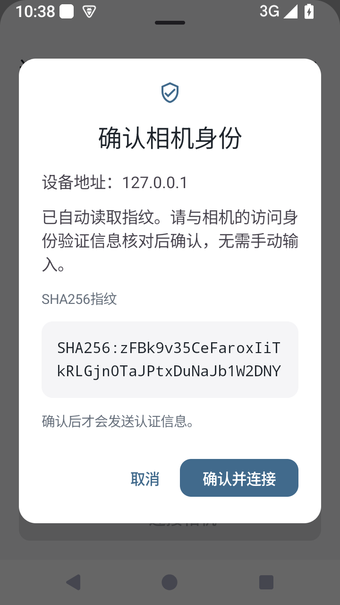
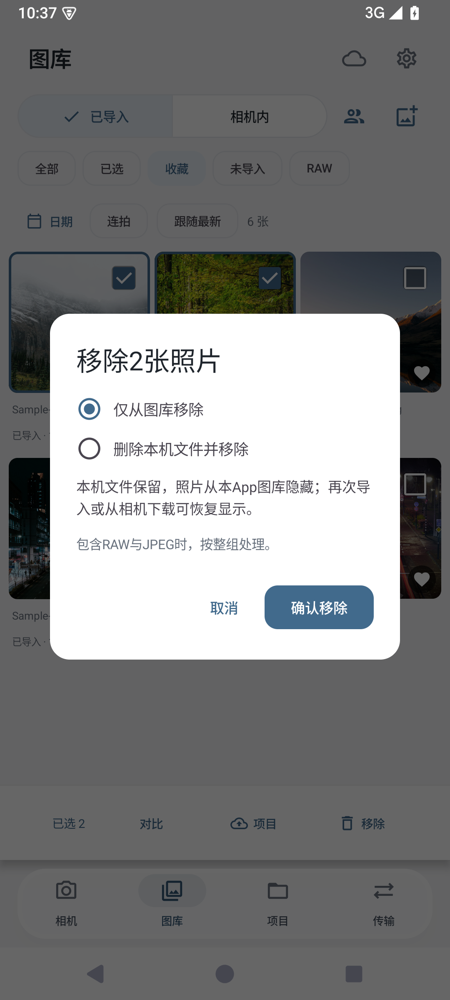

# 连接与照片管理

FrameLink 0.1.3开发测试版。此轮改动来自首次连接需要手抄指纹，以及导入照片缺少移除入口的反馈

| 自动读取并确认身份 | 照片移除 |
|---|---|
|  |  |

## 相机连接

1. 手机与相机接入同一个Wi-Fi，或让手机连接相机热点。在机身开启电脑遥控与访问身份验证，断开其他控制App的相机会话
2. 首次填写相机IP、访问认证账号和密码。眼睛按钮可显示或隐藏密码，密码键盘关闭联想输入
3. 点“连接相机”后，App只读取SSH公钥。确认框展示设备地址和完整SHA256指纹，不需要手动输入
4. 与相机显示的指纹核对后，点“确认并连接”。正式认证继续校验刚确认的公钥，读取与连接之间更换公钥会被拒绝
5. 连接成功后，地址、账号、密码和指纹使用原有Android Keystore加密保存。下次直接连接；相同地址的指纹变化会显示新旧值，重新确认后才更新

取消首次确认不保存新指纹、不发送认证信息；取消变化提示不替换旧指纹。没有自动接受新指纹或忽略公钥验证的路径。读取公钥本身不证明设备型号，实际型号由认证后的相机协议协商获得

连接按钮固定在表单底部。详细机身设置按需展开，错误显示在表单内，失败后保留输入方便修改。灰白背景、柔和蓝色、统一圆角与16dp间距沿用现有界面；照片和导航浮层的玻璃材质保留

参考：[Sony A7C II电脑遥控指南](https://helpguide.sony.net/ilc/2360/v1/zh-cn/contents/0903_pc_remote_function.html)、[Go SSH主机密钥回调](https://pkg.go.dev/golang.org/x/crypto/ssh#ClientConfig)

## 移除与删除

入口是图库多选后的“移除”，以及已导入照片大图右上角的删除图标。默认选择“仅从图库移除”

| 操作 | 本机文件 | 本App图库 |
|---|---|---|
| 仅从图库移除 | 保留 | 隐藏，可再次导入或下载恢复 |
| 删除本机文件并移除 | 删除App原片、生成的相册/导出副本及预览 | 移除，原片删除不可撤销 |

- RAW＋JPEG按一次拍摄整组处理，确认框显示所选照片数
- 最初导入的来源文件、相机卡与云端资源不在删除范围；下载后保存在App内的原片属于本机删除范围
- 仍被其他照片记录引用的文件保留，确认框会说明数量。执行前重新检查引用和文件范围，不删除确认后新增的文件
- 有未完成的关联传输时，先完成或取消任务；检查覆盖照片ID、文件URI、系统相册与文档URI，以及导出或压缩副本。实际执行与传输队列互斥
- 系统相册或文件提供方需要额外授权时，进入系统确认。拒绝或授权失效时保留照片记录和App原片，提示重试或仅移除
- 原片与相册副本删除失败会保留未完成记录；逐张保存结果，显示成功与失败项。如果只有预览缓存无法清除，会说明缓存保留，并引导到设置清理
- 已保存的现场选片与留言保留。原片删除会影响本机继续查看，云端已上传的预览与交付权限保持原有状态

数据库升级为Room3，增加本机隐藏状态，通过2→3迁移保留旧照片、任务、标记与选片记录。1→2迁移继续保留。文件删除后留下身份与历史元数据，避免FTP恢复过程自动重建已移除的图库条目；明确重新导入时恢复显示

## 本地验收入口

```sh
python3 scripts/check.py bridge
python3 scripts/check.py android
python3 scripts/check.py android-tests-build
python3 scripts/instrument.py all
```

`CameraIdentityAcceptanceTest`通过本机合成SSH相机覆盖读取、确认前零认证、取消、确认后连接、加密记忆、重连、变化提示及密码显示开关。`PhotoManagementAcceptanceTest`覆盖列表移除、完整删除、共享文件保护、关联任务、目录边界、迁移、真实界面入口与缓存清理失败反馈

验收脚本只使用独立FrameLinkQA模拟器。该模拟器的adbd以root绑定SSH反向端口22，**业务App连接相机不需要root**。SSH相机与统计服务只监听电脑127.0.0.1，合成账号和程序均不包含在业务APK中

用户反馈的同Wi-Fi连接曾在15740端口被拒绝。此轮补齐身份确认与错误恢复流程，A7C II实际固件下的连接、浏览、拍摄与蓝牙结果仍需使用新包实测，不把本机模拟测试记为真机通过
