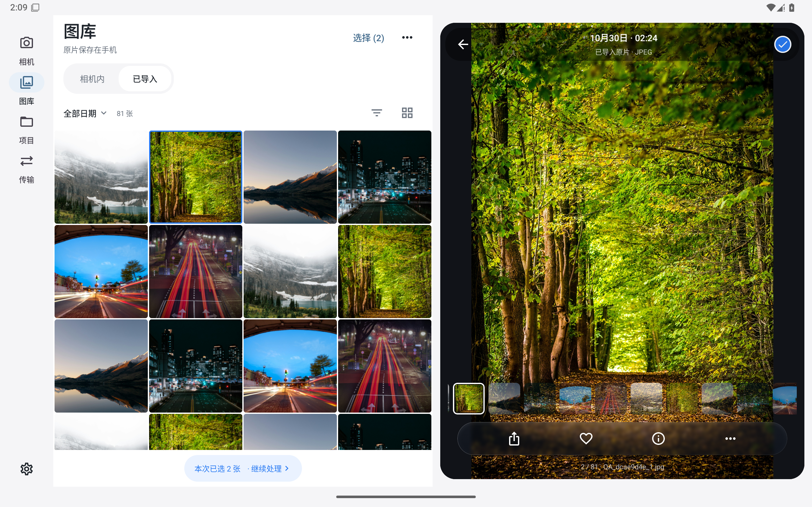
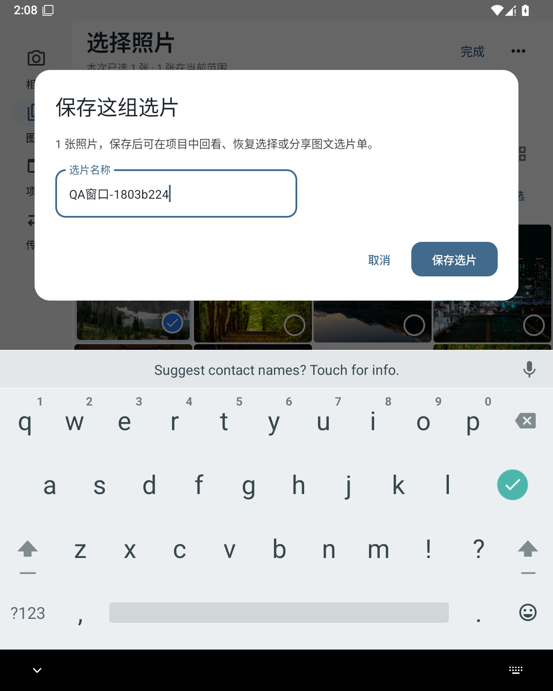

# 图库窗口适配

Android0.1.14在现有图库上增加窗口适配，相机首页、项目、传输及取景的新设计继续按已确认的v5实施。iOS尚未同步本轮布局。

## 布局

- 窗口不足600dp时使用底部导航和单栏图库
- 600dp起使用侧边导航，浏览时将空间留给网格
- 1000dp起，打开照片后使用图库与预览双栏；关闭预览恢复完整网格
- 缩略图按内容区宽度计算列数，预览展开后按左栏宽度重排；窄窗口仍保留手机5／3／2列及列表
- 大图共用网格选择，当前预览照片有描边；宽屏双图对比横向排列，窄屏纵向排列
- 窗口变化保留当前照片、选择与滚动上下文。保存选片弹层、软键盘及导入完成记录分别检查

列数在内容区测量时计算，避免先按旧宽度布局一帧、压缩列表后再更新列数。断线核对、原片导入、客户场次和选片记录沿用已有流程。

## 软件验收

独立设备：`FrameLinkTabletQA`，Android API35。11／14英寸级名称仅描述测试窗口档位，不代表已测试对应实机。

| 显示尺寸模拟 | 密度 | 逻辑窗口样本 |
|---|---|---|
| 2560×1600、1600×2560 | 320dpi | 1280×800、800×1280dp |
| 3200×2000、2000×3200 | 320dpi | 1600×1000、1000×1600dp |
| 1280×1600、852×1600 | 320dpi | 半宽640dp、三分之一宽426dp |
| 2560×1600，字体1.3倍 | 320dpi | 大字体与软键盘 |

显示尺寸模拟与真实自由窗口分开记录。自由窗口测试通过Android任务边界调整应用宽度，记录`isInMultiWindowMode`、实际窗口dp、字体、滚动位置及截图；跨活动重建后核对当前照片、选择与导入完成记录。

系统双应用分屏操作、小米平板7及更大平板真机仍待验，不用模拟器替代实机结论。

本轮软件验收包含30项JVM、33项手机安装回归、9项平板窗口测试；图库大图在解码完成后采图，实际窗口元数据与完整截图散列一并记录。





```sh
python3 scripts/run-emulator.py tablet
python3 scripts/check.py android-tests-build
python3 scripts/tablet-qa.py all
```

完整日志保存在`build-logs/android-tablet-*.log`，采集记录为`artifacts/tablet-qa-all-evidence.json`，包含主包与诊断包散列、实际窗口配置和截图散列。
