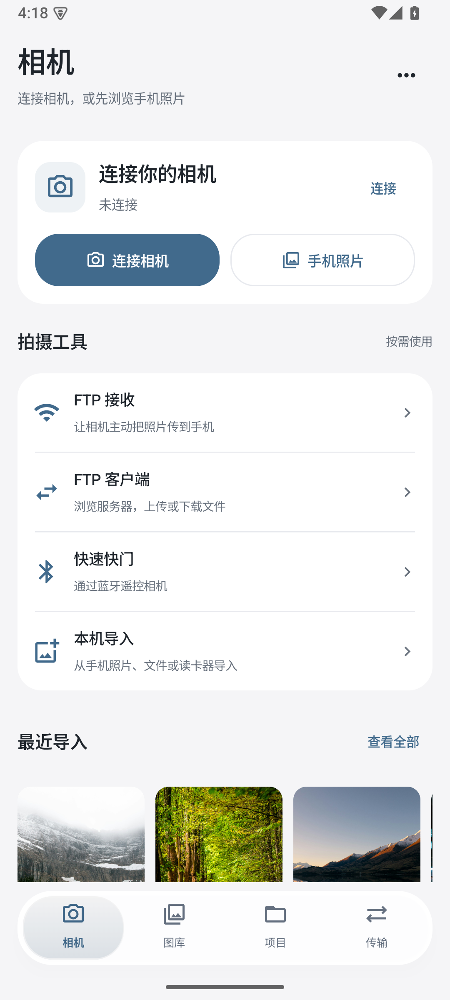
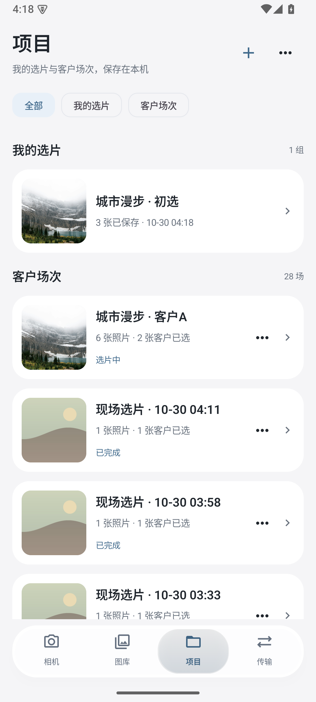
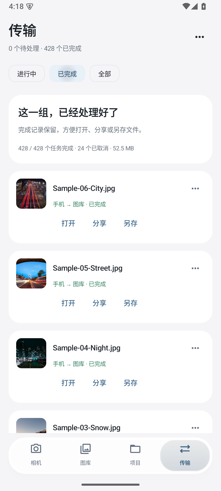

# 工作区与取景界面

Android0.1.15按已确认的v5重排四页工作区。图库沿用前两版的选片与窗口适配，相机、项目、传输和取景采用一致的标题、卡片与操作层级。iOS本轮保持0.1.6。

设计基准SHA256：`45f4423e1bcc452df7fabd3d601d4e7390d92796601c6d5fac1a021c094b4096`。

| 相机 | 项目 | 传输 |
|---|---|---|
|  |  |  |

## 实际流程

- 相机首页把连接、取景和照片浏览集中到设备卡片，FTP收发、蓝牙快门、本机导入分别保留入口；连接状态来自实际服务
- 项目区分摄影师选片与客户场次。从项目开始选照片后，可直接保存记录或建立客户场次，不要求云账号
- 客户记录先进入详情，再进入客户模式。详情大图显示只读客户选择，客户的选择与留言不改变摄影师本次选择、收藏或其他场次
- 传输显示实际队列、来源、状态与已知字节数；取消数量单列。重试、取消、打开、分享、另存、压缩副本及FTP相机重发提示继续使用原处理流程
- 新导入和相机下载任务关联已落盘文件。重复导入保留正确字节数；JPEG／RAW多文件任务在打开、分享或另存前先选文件。旧版缺少关联的任务记录继续保留，原片仍可从图库访问

## 取景

常驻参数只显示实际值与f／S／ISO／EV／WB／AF，未返回的属性不补演示值。拍照／专业只切换界面，不改机身曝光模式。展开菜单、候选值、拍摄设置继续中文。

数字参数使用离散候选值滑块，拖动只预览，松手提交一次并读回确认值。对焦模式、白平衡等枚举使用选择面板。点按画面用于对焦，点击展开面板外部先收起面板；快门与拍后接收分别管理。

横屏将快门、相册、模式和参数集中在右侧，调节面板按需浮在画面边缘；模式与菜单不挤动原比例预览。直方图保持角落小图。

## 机身色彩能力

当前PTP桥接尚未核实ST／FL等现代创意外观的完整映射，界面提示在机身调整，不使用手机画面滤镜或演示选项冒充机身设置。[libgphoto2协议头](https://github.com/gphoto/libgphoto2/blob/5f55706807397169f7d5deb7b16ff043f4ca4073/camlibs/ptp2/ptp.h)中的旧`CreativeStyle`编号不能直接当作本App已支持现代创意外观的证据。

后续品牌适配会分别接入索尼创意外观、佳能照片风格与富士胶片模拟，依照实际连接的能力、候选值和写入读回结果展示。

## 验证边界

软件验收使用授权样片、协议模拟器及独立手机／平板模拟器。日志检查连接、格式与字节、客户场次独立性、菜单与滑块、对焦不拍照、单张快门、拍后查看及旋转窗口。明暗背景的静态截图与连续操作证据按候选包散列冻结。

当前通过31项JVM、37项手机安装回归及9项窗口回归。本机导入、重复导入、JPEG／RAW文件选择、完成记录的真实文件关联和终态保护都有对应检查。

真实手机、平板、镜头对焦和新增机型的验证另行记录。设计认可、菜单可见与软件模拟通过，不代表某台机身已经完成实测。
