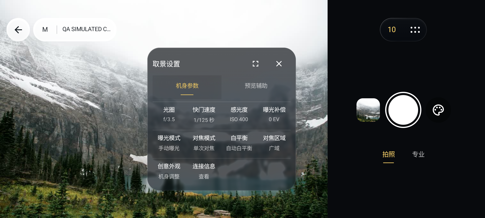
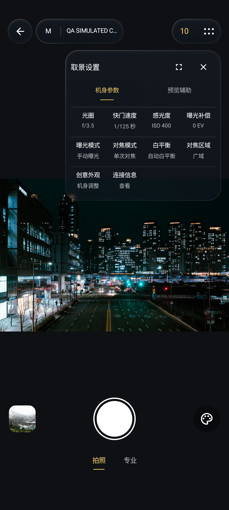

# 0.1.20取景页v6精修

本轮依据最新真机截图反馈，细化原生取景页。保留0.1.19普通启动闪退修复及首页常驻说明移除，不改图库、项目、传输的全局玻璃材质。

## 改动

- 返回入口保持44dp；曝光模式与机型合为状态组，计时与更多合为动作组。横屏动作组完整位于控制区，不跨画面边界
- 顶栏按图像左上覆盖区域选择浅底深字或暗景浅字，带滞回避免频繁切换；利用已解码图像低频读取64像素，不另解码一张图
- 横屏图库缩略图、快门、创意入口收为一组，拍照／专业沿同一轴线；切模式不挪动快门。有本地或缓存图时显示真实缩略图
- 专业浮条按可用空间出现，保持f／S／ISO／EV／WB／AF；参数尺按空间横竖排列，不遮快门或改变取景窗口
- 工具菜单去掉逐格底板与厚重选中块，以细指示、分行和文字层级区分。常规宽度上限280dp，大字减列并可滚动，中文与真实候选值保留
- 直方图HUD移出hazeSource。菜单展开时临时隐藏，关闭后按原开关恢复，不清除用户设置
- 计时关闭时显示图标，依次点击为数字3、数字10、图标。数字替换原图标，无角标或单位，中文无障碍描述与旋转保留继续有效

## 同包检查

主包SHA256：`f973a3f0403ff8e6498fc5f4ed23757ca344c6fb7378b9890f89ddf933a2ce15`

诊断组件SHA256：`725ddf734b45530b8a987f27a66c2487f0a0ab87f12583e3c2644c06999586fe`

API35独立模拟器以同一组安装包检查亮、暗背景，分别覆盖普通字号及1.5倍字号。每个背景的普通字号执行4项取景用例，大字执行菜单及计时用例；检查快门位置、画面窗口、参数区域、菜单触控尺寸、直方图恢复、计时循环与旋转，并连续执行参数、对焦、模拟快门、图库及返回取景。

36张截图、逐图散列、对应完整日志副本在本机四组camera-ui-0.1.20目录中，每组receipt.json分别记录包散列、背景、字体、图片与日志。图片是原生App经模拟相机服务运行结果，不是HTML截图，不代表Sony机身、新机型或真机视觉验收。

以下为该候选的原生运行样例。摄影作品许可与代码许可分别适用，来源署名见VISUAL_QA.md，App不预装这些样片。

| 横屏拍照 | 横屏菜单 | 竖屏菜单 |
|---|---|---|
|  |  |  |

## 未验与后续

小米17在本轮软件验证期间未连接，因此未向手机安装0.1.20或触发拍摄、机身参数写入；红米未操作。真机普通启动重复、横竖屏观感及实际响应仍待复核。旧版冻结证据保留，本轮不重复其他页面整套检查。

创意外观仍是明确未完成项：当前固定提示反映App链路尚未实现，不能写成A7C II机身没有功能。后续先读取完整能力／属性描述符，核对现代Creative Look协议，再接候选、设置、回读和异常恢复；v6示例ST或旧CreativeStyle不能替代该验证。
